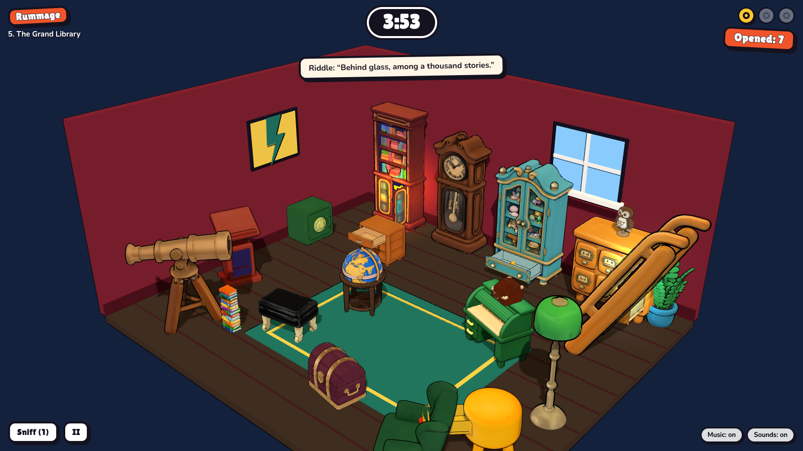

<p align="center"></p>

<h3 align="center">A hide-and-seek game where every drawer, door and lid really opens.<br>All 55 pieces of furniture were generated and articulated by Aholo Lux3D.</h3>

<p align="center">
  <a href="https://rummage-game.vercel.app"><b>▶ Play now</b></a> ·
  <a href="https://www.modelscope.ai/studios/heisemma/rummage">ModelScope Studio</a> ·
  <a href="docs/report/Rummage-report.pdf">Project report (PDF)</a> ·
  <a href="#judges-start-here">Judges start here</a>
</p>

<p align="center"></p>

**55 Lux3D pieces, 107 working joints (60 hinges, 47 sliders), every one read straight from the URDF that Lux3D's articulation returned. No hinge was rigged by hand.** `node scripts/check-live.mjs` checks all 107 against the live site: [8 of 8 passed](evidence/check-live-2026-11-18.txt).

## Judges start here

Every claim with its code, test and command: [JUDGES.md](JUDGES.md). Re-check the live claims yourself: `node scripts/check-live.mjs` (Node 20+, nothing to install).

About 90 seconds, no login, no install, works on a phone:

1. Open **[rummage-game.vercel.app](https://rummage-game.vercel.app)** → the title screen over a wizard's study.
2. Tap **Play** → the manor map → **1. The Wizard's Study** → **Start rummaging**. Tap any furniture: drawers slide, doors swing, lids lift. Find the key.
3. Back on the title screen, tap **See how Lux3D built this room** → every piece's real prompt, motion prompt, joints and generation times. Tap a card and the camera flies to the piece and plays its joints.

Chinese readers get the game in Simplified Chinese automatically (browser language), or tap **中文** at the bottom.

## The idea

Most AI 3D generators give you a statue: a shell you can look at but not use. Lux3D can also **split a model into parts and give each part a real joint**. Rummage is built on that one capability. If every generated drawer really slides and every door really swings, a room full of generated furniture becomes a hide-and-seek board, and the hiding spots are exactly the joints Lux3D produced.

The wizard has lost his manor keys. Rummage through five themed rooms by day and by night (10 levels), or hide a key yourself and send the challenge to a friend.

## How it works

1. **Prompt:** one sentence per piece: *"cartoon chest of drawers for a wizard's study, three stacked drawers with round orange knobs…"*
2. **Lux3D text-to-3D** (G1-Turbo) builds the model: median 117 s.
3. **Lux3D articulation** from a one-line motion prompt (*"each of the three drawers slides straight out forward, about 60 percent of its depth"*) returns a URDF plus one GLB per moving part: median 154 s.
4. **The game** loads the URDF with three.js + urdf-loader. Each joint becomes a clickable, springy hiding spot. Keys, decoys, padlocks and "mimics" are placed in the joints at random every run.

## The game

- **10 levels:** five Day rooms (Wizard's Study, Captain's Cabin, Haunted Kitchen, Toy Workshop, Grand Library), each adding one mechanic: **decoys**, **padlocks** (find the brass key first), **mimics** (lids that bite, +5 s) and **riddles**. Then five **Night** levels: the same rooms by flashlight, with keys hidden behind a picture or under a floorboard.
- **Fair hiding:** every openable part is equally likely to hold a key, and keys sit in a different spot inside each drawer. Checked over 1,000 runs per level: [no spot above 25%](evidence/key-stats-2026-11-18.txt).
- **Hints give clues, not arrows** ("Something that slides out, near the bookcase, by the left wall"). A second hint makes the piece glow.
- **Bets (levels 5–10):** a coin flip that pops a key out or halves your time, a safe trade, or a long shot.
- **Learn from a miss:** when time runs out the lights come on and the camera visits every key you missed.
- **Challenge a friend:** hide a key anywhere, pick a time limit, share the link. No server: the challenge lives in the URL.
- **English + Simplified Chinese**, phone and desktop, six synthesized songs, stars against par.

## Built on Aholo Lux3D

| Lux3D product | What it does here |
|---|---|
| Text-to-3D (G1-Turbo, `cartoon` style) | Every piece of furniture (55), plus 43 props and items (keys, decoys, scenery) |
| Articulation (motion prompt → URDF + per-part GLBs) | All 107 joints, which are the game's hiding spots |
| Part split | Tried in the capability probe; articulation already splits parts, so the game uses that |

Every call is logged with its prompt, task id, duration and result: [docs/generation-log.md](docs/generation-log.md). What the API really did, with timings and the issues we hit: [SPONSOR_NOTES.md](SPONSOR_NOTES.md).

## Proof

| Claim | Evidence |
|---|---|
| 55 pieces / 107 joints come from Lux3D, as shipped | [check-live output](evidence/check-live-2026-11-18.txt) · [manifest](app/public/lux3d-manifest.json) |
| Every Lux3D call is logged (prompt, task id, seconds) | [docs/generation-log.md](docs/generation-log.md) |
| All 10 levels can be won, no joint breaks | [playtest output](evidence/playtest-2026-11-18.txt) · `node tools/playtest.mjs` |
| No hiding spot is favoured | [key-stats output](evidence/key-stats-2026-11-18.txt) · `node tools/key_stats.mjs` |
| The public demo needs no API key and keeps working | check 7 in [check-live](evidence/check-live-2026-11-18.txt): static site, pre-generated assets |

## Run it

```bash
cd app
npm install
npm run dev        # http://localhost:5173
npm run build && npm run preview   # the static build that is deployed
```

Tests and checks (preview server on :4173): `node tools/playtest.mjs` · `node tools/key_stats.mjs` · `node scripts/check-live.mjs`.
Regenerating assets needs a Lux3D API key in `.env` (never committed): see `tools/lux3d_probe.py` and `tools/build_assets.sh`.

## Repository

| Path | What |
|---|---|
| `app/` | The game (Vite + three.js). `src/main.js` gameplay, `src/scene.js` URDF loading, `src/world.js` rooms, `src/i18n.js` English/Chinese |
| `app/public/models/<piece>/` | Lux3D output as shipped: `robot.urdf` + `meshes/*.glb` (compressed with gltf-transform) |
| `tools/` | Lux3D pipeline, asset build, playtest, key statistics, report and video tooling |
| `docs/report/` | Project report (PDF) and its screenshots |
| `evidence/` | Raw outputs of the checks above, dated |
| `video/` | The demo video's source (HyperFrames) |

## Limits

- **What we added on top of Lux3D**, all disclosed in the report: a dark interior inside each hollow body, a target height per piece (Lux3D scales vary), and an automatic flip for doors whose hinge pointed inward. The two "secret" spots per room (a swinging picture and a loose floorboard) are part of our room shell, not Lux3D output.
- **Generation is not live in the browser** by design: Lux3D takes about 2–4 minutes per piece and the demo must keep working without an API key until the end of 2026, so assets are pre-generated.
- In the game, all music and sound effects are synthesized in code. The demo video's narration (ElevenLabs), music and some sound effects are disclosed in the report.
- Tested on desktop Chrome and phone-sized screens in headless Chromium. Not yet tested on a low-end phone or from inside mainland China.

Built for the **Manycore Aholo Global 3D AI Hackathon** (November 2026) · AI coding assistants used: Claude and Codex · Full tool disclosure in the [report](docs/report/Rummage-report.pdf).
